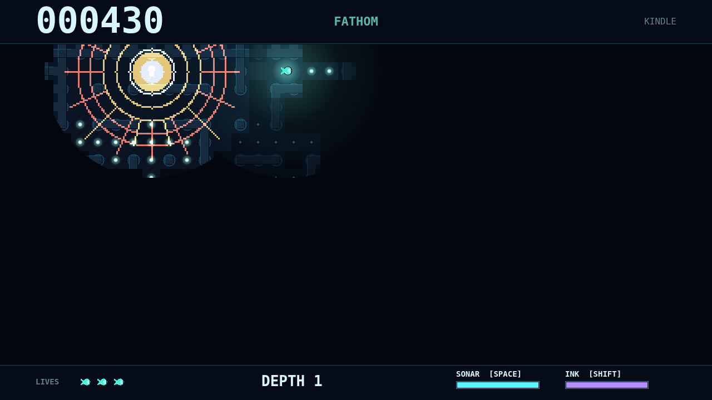

# Fathom

Fathom is a maze chase at the bottom of the sea, played almost entirely in the
dark. You are a small glowing forager threading the flooded corridors of a
trench, grazing on drifting plankton while three very different predators hunt
you. You only ever see a little circle of the world around you, and even water
you have already explored goes black again once you swim away from it.

A dive starts in total darkness. Your own soft light shows a few tiles of
corridor, and every mote of plankton you eat makes you glow brighter, widening
both your light and the window you see the maze through. Clear every mote and
the maze gives way to a deeper one, with more hunters waiting in the den. Lose
all your lives and the dark keeps you.

The catch is that your glow is also what gives you away. The Lanternjaw hunts
light, and its amber lure looks exactly like the harmless bonus jellyfish you
want to eat, so every warm glimmer in the dark is a gamble. The eyeless
Gloamfin hunts by sound: it hears you up close, sweeps the corridors with
violet sonar of its own, and comes straight for the spot where it last heard
you. The Flarefish shows nothing at all until it erupts in a blinding flare
that lights the whole neighbourhood for you both, and locks on if you are
caught inside it.

You have two tricks. A sonar ping floods the corridors around you, mapping
passages you have never seen and briefly marking the hunters lurking in them,
but every Gloamfin it reaches now knows exactly where you are. A cloud of ink
blinds the hunters that see, letting you slip past a Lanternjaw or out of a
Flarefish's sight. Knowing when to shine, when to ping and when to go dark is
the whole game.
